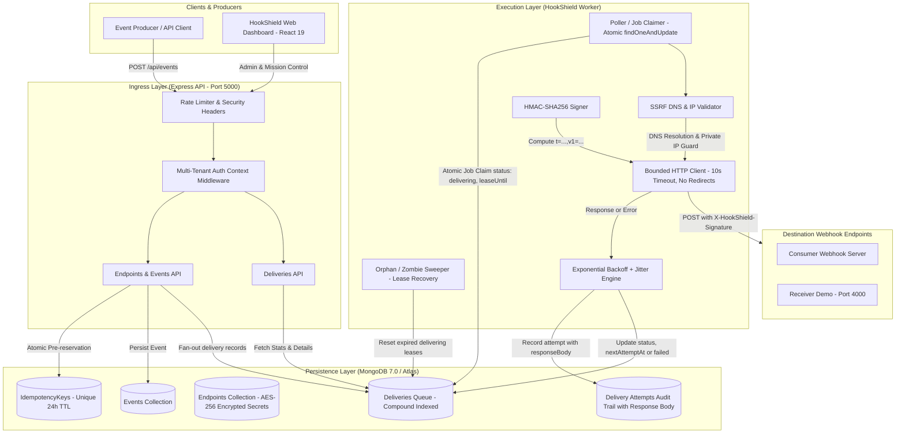
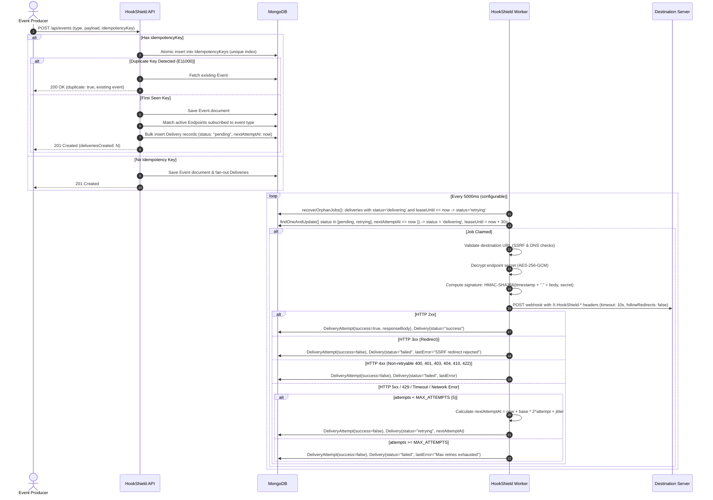

# HookShield System Architecture

HookShield is an enterprise-grade, high-throughput Webhook Reliability Platform engineered for at-least-once delivery, cryptographic authenticity verification, defense-in-depth SSRF protection, worker leasing with orphan recovery, and zero-loss exponential retry backoff.

---

## 1. High-Level Architecture

---

## 2. End-to-End Delivery Lifecycle

---

## 3. Cryptographic Security Architecture

### 3.1 Secret Storage (Envelope Encryption)
- Webhook signing secrets are encrypted at rest using **AES-256-GCM**.
- Key derivation: `SHA-256(WEBHOOK_SECRET_ENCRYPTION_KEY)` produces a 256-bit symmetric key.
- A fresh, cryptographically secure 16-byte IV is generated per endpoint.
- Ciphertext format stored in database:
  $$\text{iv}_{\text{hex}} : \text{authTag}_{\text{hex}} : \text{data}_{\text{hex}}$$
- Any bit modification to the ciphertext or IV triggers authentication failure via the GCM auth tag before decryption can execute.

### 3.2 Request Signing Protocol
Every outgoing HTTP POST request includes:
1. `X-HookShield-Signature`: `t={unix_timestamp},v1={hmac_sha256_hex}`
2. `X-HookShield-Event`: event type string (e.g. `order.created`)
3. `X-HookShield-Delivery`: unique delivery job ID

**Signature Calculation:**
$$\text{payload} = \text{timestamp} \mathbin{\Vert} \text{"."} \mathbin{\Vert} \text{rawRequestBody}$$
$$\text{signature} = \text{HMAC-SHA256}(\text{payload}, \text{secret})$$

**Verification Protocol (Receiver Side):**
1. Extract `t` and `v1` from header.
2. Validate timestamp against drift: $| \text{currentTime} - t | \le 300\text{ seconds}$ (mitigates replay attacks).
3. Compute expected HMAC-SHA256 over `${t}.${rawBody}`.
4. Compare hashes using **constant-time equality** (`crypto.timingSafeEqual`) to prevent timing side-channel attacks.

---

## 4. SSRF Defense-in-Depth Architecture

To prevent Server-Side Request Forgery attacks where a malicious user supplies an internal address (such as cloud metadata `169.254.169.254` or internal microservices `10.0.0.1`):

1. **Protocol Whitelist**: Only `http:` and `https:` schemes allowed.
2. **Loopback & Hostname Filtering**: `localhost`, `127.0.0.1`, `::1` blocked in production.
3. **DNS Resolution Verification**: Both IPv4 (`dns.resolve4`) and IPv6 (`dns.resolve6`) are resolved prior to dispatch.
4. **IP Range Blacklisting**:
   - Loopback: `127.0.0.0/8`, `::1`
   - Private RFC 1918: `10.0.0.0/8`, `172.16.0.0/12`, `192.168.0.0/16`
   - Cloud Metadata / Link-Local: `169.254.0.0/16`, `fe80::/10`
   - CGNAT: `100.64.0.0/10`
   - Reserved: `0.0.0.0/8`, `fc00::/7`
5. **No Automatic Redirects**: HTTP redirects (3xx) are rejected as terminal failures rather than being followed, closing redirect-based SSRF bypass vulnerabilities.
6. **Double Validation**: URLs are validated both at endpoint creation/update time (fail-fast API feedback) and immediately before worker HTTP dispatch (protection against DNS rebinding).

---

## 5. Retry Policy & Concurrency Control

### 5.1 Exponential Backoff with Jitter
To avoid the **thundering herd problem** where hundreds of retrying webhooks hammer a recovering recipient simultaneously, HookShield uses full jitter:

$$T_{\text{nominal}} = \min(B \times 2^{\text{attempt}}, T_{\max})$$
$$\text{delay} = T_{\text{nominal}} \times (1 \pm J)$$

Where:
- $B = 30,000\text{ ms}$ (30 seconds base delay)
- $T_{\max} = 3,600,000\text{ ms}$ (1 hour cap)
- $J = 0.3$ (30% random jitter)
- $\text{Max Attempts} = 5$

### 5.2 Concurrency & Worker Atomic Claims
- Workers poll `deliveries` using MongoDB `findOneAndUpdate` with atomic state transitions:
  - Match: `{ status: { $in: ['pending', 'retrying'] }, nextAttemptAt: { $lte: new Date() } }`
  - Update: `{ $set: { status: 'delivering', leaseUntil: new Date(now + 30000) } }`
- This ensures **zero duplicate worker claims** even when running 50+ concurrent worker instances without external locking services like Redis Redlock.
- An automated sweeper recovers abandoned jobs where `leaseUntil` has elapsed, preventing permanently hung delivery pipelines.
